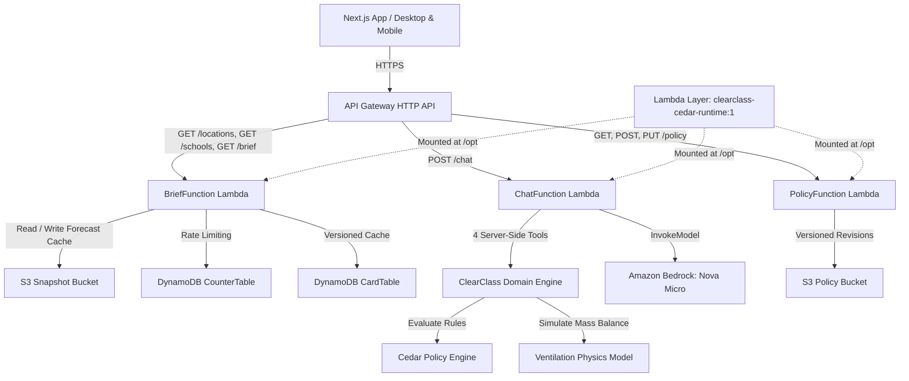

# ClearClass · School Decision Engine

> **A location-agnostic decision-support engine for school leaders, PE coordinators, and teachers.**
> Rules and physics decide; Amazon Bedrock and Strands explain, translate, and converse.

Built for **Environmental Hacks (Bharat Builds Tour 2026), Track 01 Air**.
Deployed in **AWS Sydney (`ap-southeast-2`)**.
- **Live Web Application (AWS Amplify):** [https://main.d3njtglhf8ccp.amplifyapp.com](https://main.d3njtglhf8ccp.amplifyapp.com)
- **Live Production API (Amazon API Gateway):** `https://04ixg1iqd4.execute-api.ap-southeast-2.amazonaws.com`

---

## The Problem

Air pollution dashboards report raw numbers (e.g., "AQI 210, PM2.5 130 µg/m³"), but school staff face urgent operational decisions before the morning bell at 06:30–08:30:
- *Can students hold morning assembly in the courtyard?*
- *Should physical education (PE) be cancelled, shortened, or moved indoors?*
- *When should teachers open classroom windows to flush out exhaled CO2 without filling rooms with hazardous outdoor particulates?*
- *What clear, trusted message can be sent to parents in English and Hindi right now?*

Generic LLM wrappers hallucinate medical guarantees or invent arbitrary duration rules. Raw weather apps offer no school cohort context.

## The ClearClass Solution

ClearClass separates deterministic rules and physics from natural language explanation:
1. **Cedar Policy Evaluation:** Evaluates typed Cedar policy sets based on published school guidance (U.S. EPA / AirNow school guide adaptation). Every recommendation provides formal `@id` rule and primary source citations.
2. **Comparative Ventilation Physics:** Uses an analytic 5-minute single-zone mass-balance differential equation ($dC/dt = \lambda P C_{out} - (\lambda + k) C$ for PM2.5; $dC/dt = G/V + \lambda (C_{out} - C)$ for CO2) to schedule optimal window-opening flush intervals during lesson breaks.
3. **Bilingual Parent Notices:** Produces deterministic, ready-to-copy English and Hindi broadcast templates with one-click clipboard copying.
4. **Grounded Conversational Assistant:** Uses AWS Strands and **Amazon Nova Micro** (`amazon.nova-micro-v1:0`) closed over 4 server-side tools (`get_school_profile`, `get_air_quality`, `evaluate_policy`, `plan_ventilation`). The LLM is strictly tool-grounded; it explains and converses without inventing safety clearances.
5. **Location Agnostic:** Supports arbitrary global places via GeoNames-backed Open-Meteo geocoding and CAMS Global atmospheric forecasts (~45 km grid resolution).

---

## System Architecture



### AWS Services Employed

- **Amazon Bedrock:** `amazon.nova-micro-v1:0` in Sydney (`ap-southeast-2`) for bounded, grounded bilingual chat (`max_tokens: 512`, `temperature: 0`).
- **AWS Lambda:** Serverless compute for Brief, Chat, and Policy management running Python 3.12 x86_64 with lean 195 KB application packages and shared dependency layers.
- **Amazon API Gateway HTTP API:** Low-latency regional API routing with CORS support and throttling limits (burst 5, rate 2 req/s).
- **Amazon DynamoDB:**
  - `CounterTable`: Atomic conditional request counters enforcing daily abuse limits.
  - `CardTable`: Versioned daily decision card cache using canonical composite identity keys and TTL cleanup.
- **Amazon S3:** Private versioned bucket storing immutable Cedar policy revisions (`policies/`), CAMS Global forecast snapshots (`air/`), and geocoded location cache (`locations/`).
- **Amazon CloudWatch:** Structured 7-day log retention for auditing and observability.

---

## Key Endpoints

| Method | Path | Description |
|---|---|---|
| `GET` | `/schools` | List seeded school templates and scenario fixtures. |
| `GET` | `/locations?query=<text>&lang=en\|hi` | Bounded place search returning up to 5 GeoNames matches. |
| `GET` | `/schools/{id}/brief?locationId=<id>&scenario=<name>` | Full DailyCard response with verdicts, ventilation, and parent messages. |
| `POST` | `/schools/{id}/chat` | Grounded chat with Strands agent and Bedrock Nova Micro. |
| `GET` | `/policy?packId=reference-school-activity` | Read active Cedar policy pack manifest, schema, and rules. |
| `POST` | `/policy/validate` | Validate submitted Cedar policies against schema without writing. |
| `PUT` | `/policy` | Token-protected optimistic-concurrency write for policy pack updates. |

---

## Verifiable Sources & Data Provenance

1. **U.S. EPA & AirNow School Outdoor Activity Guidance:**
   - Publication: [EPA-456/F-14-003](https://document.airnow.gov/air-quality-and-outdoor-guidance-for-schools.pdf)
   - U.S. AQI Categories: [AirNow Basics](https://www.airnow.gov/aqi/aqi-basics/)
2. **Classroom Ventilation & CO2 Indicators:**
   - UK Department for Education: [Ventilation in Education and Childcare](https://www.gov.uk/government/publications/ventilation-and-air-quality-in-education-and-childcare-settings/ventilation-and-air-quality-in-education-and-childcare-settings)
   - Building Performance Study: [Estover Community College Campus, Appendix 10.9](https://www.usablebuildings.co.uk/UsableBuildings/Unprotected/BPEArchive/EstoverCommunityCollegeCampus.pdf)
   - ASHRAE: Standard 62.1-2016 Addendum d (0.31 L/min/person CO2 generation) & 2024 Indoor CO2 Position Document (426 ppm outdoor baseline).
   - U.S. EPA Exposure Factors Handbook: [Chapter 19, Table 19-6](https://nepis.epa.gov/Exe/ZyPURL.cgi?Dockey=P100UZMY.txt) (PM2.5 deposition rate $k = 0.39\text{ h}^{-1}$).
3. **Atmospheric Forecasts & Geocoding:**
   - Copernicus CAMS Global atmospheric model (~45 km grid resolution) via [Open-Meteo Air Quality API](https://open-meteo.com/en/docs/air-quality-api).
   - GeoNames database via [Open-Meteo Geocoding API](https://open-meteo.com/en/docs/geocoding-api).

---

## Local Development & Testing

```bash
# 1. Clone repository
git clone https://github.com/Skrisps26/clearclass.git
cd clearclass

# 2. Set up Python virtual environment
uv venv .venv --python 3.12
source .venv/bin/activate
uv pip install -r backend/requirements.txt -c backend/requirements.lock

# 3. Run all 72 backend unit tests
python -m unittest discover -s backend/tests -v

# 4. Run deployed cloud verification tests (requires AWS credentials)
python scripts/smoke_air.py
python scripts/smoke_chat.py
python scripts/smoke_policy.py

# 5. Build and run Next.js frontend
cd frontend
npm install
npm run build
npx serve out
```

---

## Honest Disclosures & Boundaries

- **Forecasts, Not Measurements:** CAMS Global values are numerical model simulations, not campus-grade air quality monitors.
- **Reference Adaptation, Not Law:** Outdoor activity advice is an adaptation of cited public guidelines. It does NOT assert legal compliance or local authority directives (such as Delhi CAQM GRAP).
- **Physical Estimates, Not Guarantees:** Classroom ventilation schedules are single-zone mass-balance approximations. They do not replace local fire, safety, acoustic, or security guidelines.
- **Zero Medical Advice:** ClearClass provides operational decision support for school activities; it makes no medical or health outcome claims.
