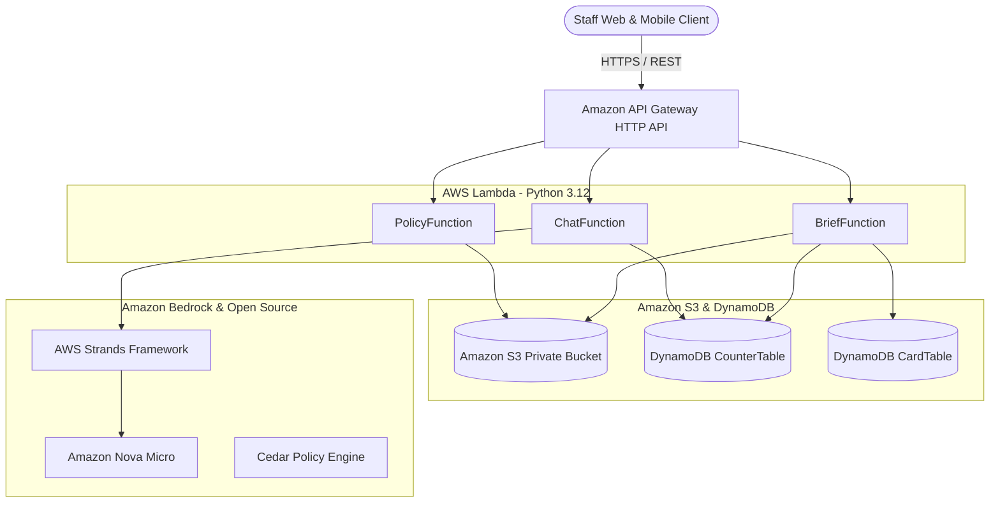

# Building ClearClass: A Location-Agnostic School Air-Quality Decision Engine with Cedar, Strands, and Amazon Bedrock

*By the ClearClass Engineering Team · Published for the Bharat Builds Tour 2026, Track 01 Air*

---

## 1. The Real Operational Challenge

Every winter across Northern India and industrialized metropolitan basins worldwide, schools face a recurring air-quality crisis. When ambient PM2.5 concentrations surge into the hundreds of micrograms per cubic meter, school leaders face time-critical operational questions before the 08:00 morning bell:

- *Can students assemble outside for morning prayer?*
- *Should physical education (PE) be cancelled, shortened, or relocated indoors?*
- *When should teachers open classroom windows to flush out exhaled CO2 without filling rooms with hazardous outdoor particulates?*
- *What clear, trusted message can be sent to parents in English and Hindi right now?*

Standard air quality monitoring apps provide numbers—an AQI value or a color-coded gauge. But a raw number does not constitute an operational decision. Conversely, asking an ungrounded general-purpose Large Language Model (LLM) risks catastrophic hallucinations: arbitrary "safe minutes," invented cancellation rules, or medical outcome guarantees that no responsible educator can rely upon.

We built **ClearClass** to solve this dilemma with a foundational architectural principle:

> **"Rules and physics decide; the LLM explains, translates, and converses."**

---

## 2. Architectural Overview

ClearClass is deployed entirely in **AWS Sydney (`ap-southeast-2`)** using a serverless, decoupled architecture.



### Key Architectural Components

1. **Amazon API Gateway HTTP API:** Provides low-latency regional routing with CORS support, default stage auto-deployment, and granular throttling (burst limit 5, rate limit 2 requests/second).
2. **AWS Lambda:** Three independent Python 3.12 functions (`BriefFunction`, `ChatFunction`, and `PolicyFunction`) sharing common domain logic. Application packages are streamlined to ~200 KB, referencing a shared Lambda layer for native Rust/C bindings.
3. **Amazon DynamoDB:**
   - `CounterTable`: Enforces atomic, conditional per-client and global daily request limits using DynamoDB's `update_item` with `ConditionExpression="attribute_not_exists(hits) OR hits < :limit"`.
   - `CardTable`: Caches full `DailyCard` JSON responses under composite identity keys (incorporating school ID, location coordinates, timezone, local date, scenario ID, and policy version).
4. **Amazon S3:** Private, versioned bucket storing immutable Cedar policy revisions (`policies/`), atmospheric forecast snapshots (`air/`), and geocoded location records (`locations/`).
5. **Amazon Bedrock:** Sydney-native `amazon.nova-micro-v1:0` invoked through the open-source AWS Strands framework for tool-grounded, bilingual conversational guidance.

---

## 3. Deterministic Decision Engine: Cedar Policy Language

Rather than relying on prompt engineering to enforce safety boundaries, ClearClass evaluates policies using **Cedar**, the open-source policy language developed by AWS.

### The Cedar Schema

We created a typed schema with entities for `Staff`, `Cohort`, and `School`, and specific actions representing physical school activities:

```cedar
entity Staff;
entity Cohort;
entity School;

action ordinary_outdoor appliesTo {
    principal: Staff,
    resource: School,
    context: { aqi: Long, cohort: Cohort }
};

action prolonged_intense_sport appliesTo {
    principal: Staff,
    resource: School,
    context: { aqi: Long, cohort: Cohort }
};

action sport_with_breaks_reduced_intensity appliesTo {
    principal: Staff,
    resource: School,
    context: { aqi: Long, cohort: Cohort }
};

action indoor_relocation_or_reschedule appliesTo {
    principal: Staff,
    resource: School,
    context: { aqi: Long, cohort: Cohort }
};
```

### Policy Rules Grounded in U.S. EPA Guidance

Our reference policy pack adapts the official [U.S. EPA / AirNow School Outdoor Activity Guidance](https://document.airnow.gov/air-quality-and-outdoor-guidance-for-schools.pdf):

```cedar
@id("reference-school-activity.allow-sport-through-moderate")
@source("epa-airnow-school-guide:p1")
permit (
    principal,
    action == Action::"prolonged_intense_sport",
    resource
)
when {
    context.aqi >= 0 && context.aqi <= 100
};

@id("reference-school-activity.allow-sport-usg-modified")
@source("epa-airnow-school-guide:p1")
permit (
    principal,
    action == Action::"sport_with_breaks_reduced_intensity",
    resource
)
when {
    context.aqi >= 101 && context.aqi <= 150
};

@id("reference-school-activity.forbid-outdoor-very-unhealthy")
@source("epa-airnow-school-guide:p1")
forbid (
    principal,
    action in [
        Action::"ordinary_outdoor",
        Action::"prolonged_intense_sport",
        Action::"sport_with_breaks_reduced_intensity"
    ],
    resource
)
when {
    context.aqi >= 201 && context.aqi <= 300
};
```

By evaluating candidate alternatives from least to most restrictive, Cedar deterministically returns `allow`, `modify` (with specified measures), or `deny`. Every decision emitted by ClearClass attaches the exact rule `@id` and source URL, ensuring teachers and parents can verify why an activity was altered.

---

## 4. The Physics of Indoor Air: Single-Zone Mass Balance

A major danger during pollution spikes is sealing classrooms shut all day, causing indoor CO2 concentrations to surge past 2,500 ppm, impairing cognitive function and causing headaches.

ClearClass implements an analytic single-zone mass-balance differential equation solved in 5-minute time steps:

$$\frac{dC_{\text{PM}}}{dt} = \lambda P C_{\text{out}} - (\lambda + k) C_{\text{PM}}$$

$$\frac{dC_{\text{CO2}}}{dt} = \frac{G}{V} + \lambda (C_{\text{out}} - C_{\text{CO2}})$$

Where:
- $\lambda$ = Air exchange rate (ACH): $0.5\text{ h}^{-1}$ closed; $5.0\text{ h}^{-1}$ open (cited from the UK Estover Community College Building Performance Evaluation).
- $P$ = PM2.5 penetration factor: $0.8$ (cited from U.S. EPA IECCU Tutorial 7).
- $k$ = PM2.5 deposition rate: $0.39\text{ h}^{-1}$ (cited from U.S. EPA Exposure Factors Handbook, Table 19-6).
- $G$ = Occupant CO2 generation rate: $0.31\text{ L/min/person}$ for adult sedentary activity (ASHRAE Standard 62.1 Addendum d).
- $C_{\text{out}}$ = 426 ppm CO2 outdoor baseline (ASHRAE 2024 Indoor CO2 Position Document).

The engine evaluates six hourly 10-minute flush schedules (conforming to UK Department for Education ventilation advice) to find the schedule that minimizes cumulative PM2.5 inhalation while keeping CO2 below the 1,500 ppm comfort threshold.

---

## 5. Conversational Intelligence with Strands & Amazon Nova Micro

To allow school staff to converse with the system in natural language, we implemented `ChatFunction` using AWS's open-source **Strands** framework and **Amazon Bedrock Nova Micro** (`amazon.nova-micro-v1:0`).

Instead of giving the model open-ended access to generate advice, the agent is strictly closed over four domain tools:

1. `get_school_profile()`: Resolves the school template and IANA timezone.
2. `get_air_quality()`: Retrieves the current modelled CAMS Global PM2.5, PM10, and U.S. AQI reference.
3. `evaluate_policy(activity, cohort)`: Runs Cedar authorization for specific activities and student cohorts.
4. `plan_ventilation()`: Solves the differential mass-balance equations for classroom airing times.

When a teacher asks:
> *"Can students do physical education (PE) outside this morning?"*

The agent calls `get_air_quality()` and `evaluate_policy("pe", "all_students")`, receives the verified Cedar decision, and explains the outcome concisely. When a question is asked in Hindi:
> *"क्या आज दोपहर में बच्चे बाहर फुटबॉल खेल सकते हैं?"*

The agent converses fluently in Devanagari Hindi, citing the specific modifications (विराम बढ़ाएं, तीव्रता कम रखें) mandated by the underlying Cedar rules.

---

## 6. Engineering Challenges & Lessons Learned

### Lesson 1: Layer Reuse Over Slow Uplinks
During initial deployments from a remote workstation with 431 ms latency to Sydney, uploading a 34 MB standalone bundle repeatedly stalled. We solved this by publishing an immutable Lambda layer (`clearclass-cedar-runtime:1`) directly from an existing Sydney S3 object, reducing function deployment packages to just **195 KB**. Subsequent deploys took under 15 seconds.

### Lesson 2: DynamoDB Decimal Serialization
Boto3's DynamoDB serializer strictly prohibits Python `float` types. Instead of lossy string conversions, our `CardStore` utilizes `json.loads(..., parse_float=Decimal)` on put and a recursive `_un_decimal` deserializer on get, preserving exact `float` and `int` types across roundtrips.

---

## 7. Conclusion

ClearClass demonstrates how AI and formal verification can work hand-in-hand. By grounding generative AI in formal Cedar policies and physics-based differential equations, we can give educators the certainty, speed, and transparency they need to keep students safe.

- **GitHub Repository:** [https://github.com/Skrisps26/clearclass](https://github.com/Skrisps26/clearclass)
- **Live Sydney API:** `https://04ixg1iqd4.execute-api.ap-southeast-2.amazonaws.com`
